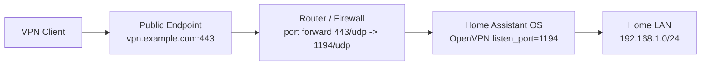

# Home Assistant OpenVPN Server Add-on

OpenVPN server add-on for `Home Assistant OS`.

Chinese documentation: [README.zh-CN.md](README.zh-CN.md)

## Overview

This repository provides a Home Assistant Add-on that:

- runs an OpenVPN server on `Home Assistant OS`
- initializes and manages PKI with EasyRSA
- gives VPN clients access to the home LAN through pushed routes plus NAT
- ships an add-on panel (Home Assistant ingress) for clients, health and diagnostics
- supports client issue and revoke workflows from the panel, from the CLI, or from shared request files

## Installation

1. In Home Assistant, open `Settings -> Add-ons -> Add-on Store -> Repositories`.
2. Add this repository URL:

```text
https://github.com/Thweki/ha-addon-openvpn-server
```

3. Install `OpenVPN Server`.
4. Configure the add-on.
5. Start the add-on.

## Basic Configuration

Recommended example:

```yaml
public_endpoint: vpn.example.com
listen_port: 1194
public_port: 443
protocol: udp
lan_networks: 192.168.1.0/24
nat_enabled: true
dns: 1.1.1.1, 8.8.8.8
extra_routes: ""
```

Field summary:

- `public_endpoint`: public domain or public IP used by clients
- `listen_port`: local port OpenVPN listens on
- `public_port`: public port written into exported `.ovpn` files
- `lan_networks`: LAN subnets clients should reach, comma-separated
- `nat_enabled`: required for clients to reach LAN devices
- `dns`: DNS servers pushed to clients, comma-separated
- `extra_routes`: optional extra pushed routes, comma-separated

## The Add-on Panel

`Settings -> Add-ons -> OpenVPN Server -> Open Web UI` (administrators only):

- **Health**: LAN forwarding/NAT, `ip_forward`, CRL validity, port mapping and configuration warnings
- **Clients**: issue, revoke, see who is online and download `.ovpn` profiles
- **Maintenance**: rebuild the CRL, restart OpenVPN, download a diagnostics bundle

## Common Deployment Examples

### Standard Home Setup

```yaml
public_endpoint: vpn.example.com
listen_port: 1194
public_port: 1194
protocol: udp
lan_networks: 192.168.1.0/24
dns: 192.168.1.1, 1.1.1.1
extra_routes: ""
```

Use this when your router forwards `1194/udp` directly to Home Assistant.

### Port Forwarding With Different External Port

```yaml
public_endpoint: vpn.example.com
listen_port: 1194
public_port: 443
protocol: udp
lan_networks: 192.168.1.0/24
dns: 1.1.1.1, 8.8.8.8
extra_routes: ""
```

Use this when your router exposes `443/udp` outside and forwards it to `1194/udp` on Home Assistant.

### Multiple Internal Networks

```yaml
public_endpoint: vpn.example.com
listen_port: 1194
public_port: 1194
protocol: udp
lan_networks: 192.168.1.0/24, 192.168.2.0/24
dns: 192.168.1.1
extra_routes: 10.10.0.0/16
```

Use this when VPN clients need routes to more than one internal subnet.

## Port Mapping Diagram



## Client Certificates

Two modes, selected by `duplicate_cn`:

| `duplicate_cn` | Behaviour |
| --- | --- |
| `false` (recommended) | One certificate per device. Each client gets a fixed VPN address (`fixed_client_ips`), so router and firewall rules stay predictable and revoking one device leaves the others alone. |
| `true` | One profile can be shared by several devices at once. Revoking that certificate logs out all of them, and fixed addresses are disabled. |

Issue and revoke from the panel, or over the CLI:

```bash
openvpn-addon client create iphone
openvpn-addon client revoke iphone
openvpn-addon client list
```

## Client Profiles

Client profiles embed the client private key and are written with mode `0600`. Download them from the panel.

Setting `publish_profiles_to_share: true` also copies them to `/share/openvpn_server/clients/`. That path is readable by other add-ons, so leave it off unless you need it.

## Request Files (optional, scriptable)

Write a file into `/share/openvpn_server/requests/` and it is applied while the add-on runs — no restart, no dropped sessions:

```json
{"action":"issue","client_name":"iphone"}
```

```json
{"action":"revoke","client_name":"iphone"}
```

Outputs:

- results: `/share/openvpn_server/results/`
- processed requests: `/share/openvpn_server/archive/`
- invalid requests: `/share/openvpn_server/rejected/` (with a result file explaining the reason)

Malformed request files are quarantined instead of stopping the add-on.

## Notes

- If `public_endpoint` is empty, client export is skipped.
- If `public_port` differs from `listen_port`, your router must forward the external port to the local one.
- If `nat_enabled` is off, clients can reach only the VPN server itself even when `lan_networks` is set.
- If `lan_networks` is empty, clients will not automatically receive home LAN routes.
- `dns`, `lan_networks`, and `extra_routes` accept comma-separated values.
- Prefer `protocol: udp`. Use TCP only when your network blocks UDP.
- For troubleshooting see [addon/DOCS.md](addon/DOCS.md), or use the panel's **Download diagnostics**.
- Change history: [addon/CHANGELOG.md](addon/CHANGELOG.md).
