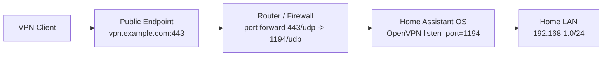

# Home Assistant OpenVPN Server Add-on

OpenVPN server add-on for `Home Assistant OS`.

Chinese documentation: [README.zh-CN.md](README.zh-CN.md)

## Overview

This repository provides a Home Assistant Add-on that:

- runs an OpenVPN server on `Home Assistant OS`
- initializes and manages PKI with EasyRSA
- exports client profiles to the Home Assistant share folder
- supports LAN route push and NAT-based home network access
- supports client issue and revoke workflows through shared request files

## Installation

1. In Home Assistant, open `Settings -> Add-ons -> Add-on Store -> Repositories`.
2. Add this repository URL:

```text
https://github.com/Thweki/ha-addon-openvpn-server
```

3. Install `OpenVPN Server`.
4. Configure the add-on.
5. Start the add-on.

## Basic Configuration

Recommended example:

```yaml
public_endpoint: vpn.example.com
listen_port: 1194
public_port: 443
protocol: udp
lan_networks: 192.168.1.0/24
dns: 1.1.1.1, 8.8.8.8
extra_routes: ""
```

Field summary:

- `public_endpoint`: public domain or public IP used by clients
- `listen_port`: local port OpenVPN listens on
- `public_port`: public port written into exported `.ovpn` files
- `lan_networks`: LAN subnets clients should reach, comma-separated
- `dns`: DNS servers pushed to clients, comma-separated
- `extra_routes`: optional extra pushed routes, comma-separated

## Common Deployment Examples

### Standard Home Setup

```yaml
public_endpoint: vpn.example.com
listen_port: 1194
public_port: 1194
protocol: udp
lan_networks: 192.168.1.0/24
dns: 192.168.1.1, 1.1.1.1
extra_routes: ""
```

Use this when your router forwards `1194/udp` directly to Home Assistant.

### Port Forwarding With Different External Port

```yaml
public_endpoint: vpn.example.com
listen_port: 1194
public_port: 443
protocol: udp
lan_networks: 192.168.1.0/24
dns: 1.1.1.1, 8.8.8.8
extra_routes: ""
```

Use this when your router exposes `443/udp` outside and forwards it to `1194/udp` on Home Assistant.

### Multiple Internal Networks

```yaml
public_endpoint: vpn.example.com
listen_port: 1194
public_port: 1194
protocol: udp
lan_networks: 192.168.1.0/24, 192.168.2.0/24
dns: 192.168.1.1
extra_routes: 10.10.0.0/16
```

Use this when VPN clients need routes to more than one internal subnet.

## Port Mapping Diagram



## Client Profiles

Default client profile:

- `/share/openvpn_server/clients/homeassistant.ovpn`

Issue a new client:

- create `/share/openvpn_server/requests/<name>.json`
- request body:

```json
{"action":"issue","client_name":"iphone"}
```

Revoke a client:

- create `/share/openvpn_server/requests/<name>.json`
- request body:

```json
{"action":"revoke","client_name":"iphone"}
```

Request processing outputs:

- profiles: `/share/openvpn_server/clients/`
- results: `/share/openvpn_server/results/`
- archive: `/share/openvpn_server/archive/`

## Notes

- If `public_endpoint` is empty, client export is skipped.
- If `public_port` differs from `listen_port`, your router or firewall must forward the external port to the Home Assistant host.
- If `lan_networks` is empty, clients will not automatically receive home LAN routes.
- `dns`, `lan_networks`, and `extra_routes` accept comma-separated values.
