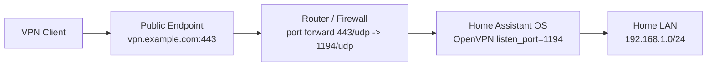

# OpenVPN Server

OpenVPN server add-on for `Home Assistant OS`.

Repository:

- [https://github.com/Thweki/ha-addon-openvpn-server](https://github.com/Thweki/ha-addon-openvpn-server)

Chinese documentation:

- [README.zh-CN.md](https://github.com/Thweki/ha-addon-openvpn-server/blob/main/README.zh-CN.md)

## Overview

- Runs an OpenVPN server on `Home Assistant OS` and manages the PKI with EasyRSA.
- Gives VPN clients access to your home LAN through pushed routes plus NAT.
- Ships an add-on panel (Home Assistant ingress) for clients, health and diagnostics.

## Quick Start

Recommended configuration:

```yaml
public_endpoint: vpn.example.com
listen_port: 1194
public_port: 443
protocol: udp
lan_networks: 192.168.1.0/24
nat_enabled: true
dns: 1.1.1.1, 8.8.8.8
```

Then open the add-on and use **Open Web UI** to see health, issue clients and download profiles.

## The Add-on Panel

`Settings -> Add-ons -> OpenVPN Server -> Open Web UI` (administrators only):

- **Health** — LAN forwarding, `ip_forward`, CRL validity, port mapping and configuration warnings.
- **Clients** — who exists, who is online, the fixed VPN address, one-click issue/revoke and `.ovpn` download.
- **Maintenance** — rebuild the CRL, restart OpenVPN, download a diagnostics bundle for bug reports.

## Client Certificates

Two modes, selected by `duplicate_cn`:

| `duplicate_cn` | Behaviour |
| --- | --- |
| `false` (recommended) | One certificate per device. Each client gets a fixed VPN address (`fixed_client_ips`) which makes router and firewall rules predictable. Revoking one device does not affect the others. |
| `true` | One profile can be used by several devices at once. Revoking that certificate logs out all of them, and fixed addresses are disabled because one shared certificate cannot be pinned to one address. |

Client profiles are downloaded from the panel. They embed the client private key, so they are written with mode `0600` and are **not** copied to `/share` unless you set `publish_profiles_to_share: true`.

## Request Files (optional, scriptable)

Requests written to `/share/openvpn_server/requests/` are applied while the add-on runs — no restart needed:

```json
{"action":"issue","client_name":"iphone"}
```

```json
{"action":"revoke","client_name":"iphone"}
```

Output:

- profiles: `/share/openvpn_server/clients/` (only when `publish_profiles_to_share` is on)
- results: `/share/openvpn_server/results/`
- processed requests: `/share/openvpn_server/archive/`
- invalid requests: `/share/openvpn_server/rejected/` (with an explanatory result file)

Malformed request files never stop the add-on.

## Port Mapping



## Notes

- If `public_endpoint` is empty, client export is skipped.
- If `public_port` differs from `listen_port`, your router must forward the external port to the local one.
- `nat_enabled` must stay on for clients to reach LAN devices; turning it off leaves clients able to reach only the VPN server itself.
- `lan_networks`, `dns` and `extra_routes` accept comma-separated values.
- Prefer UDP. Use TCP only when your network blocks UDP.
- The panel listens on the Supervisor bridge and is reached through Home Assistant ingress; do not port-forward it.

See [DOCS.md](addon/DOCS.md) for troubleshooting and [addon/CHANGELOG.md](addon/CHANGELOG.md) for the change history.
